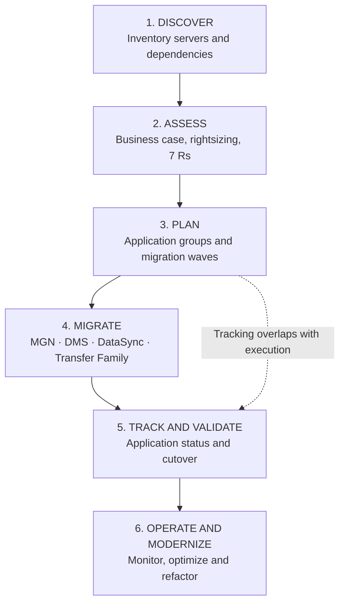
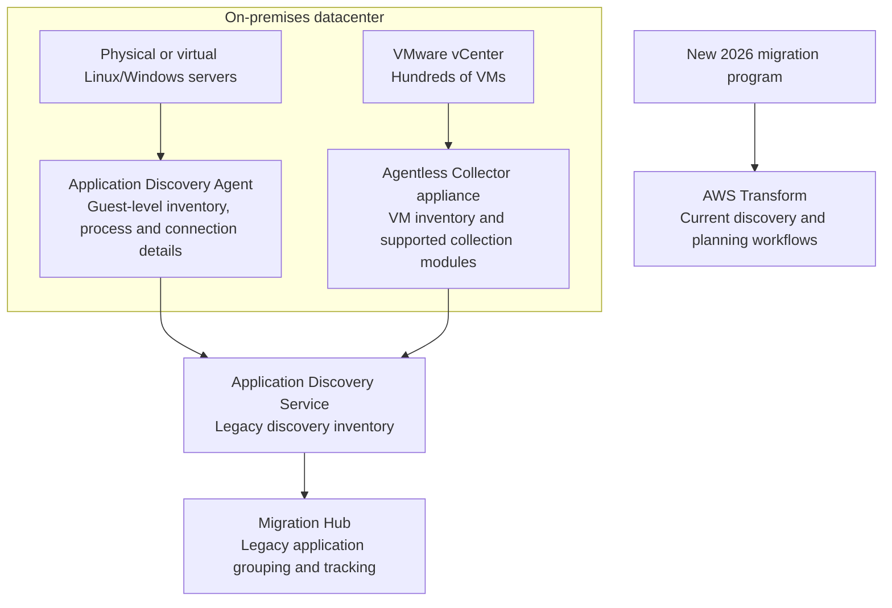
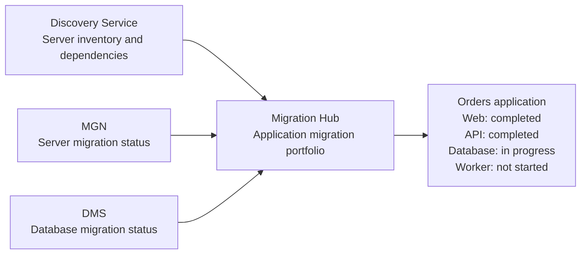
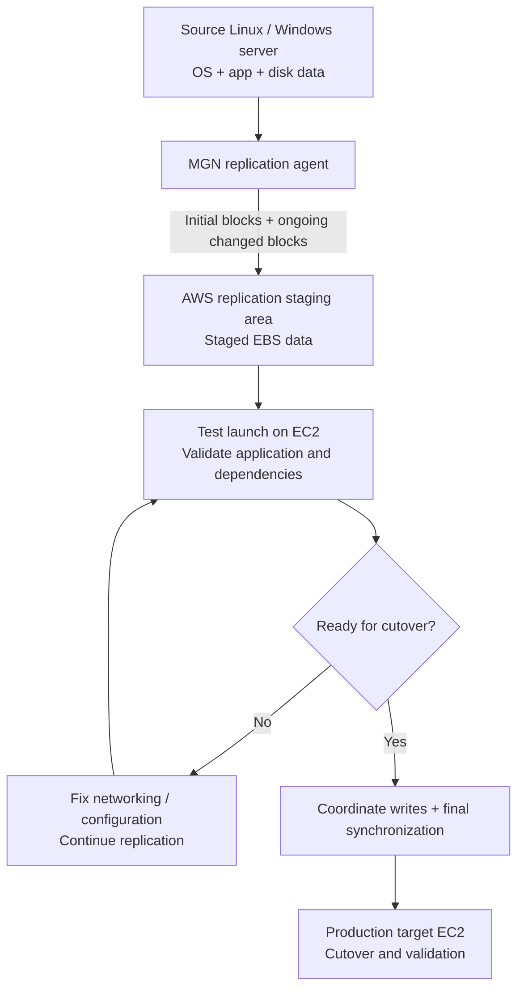
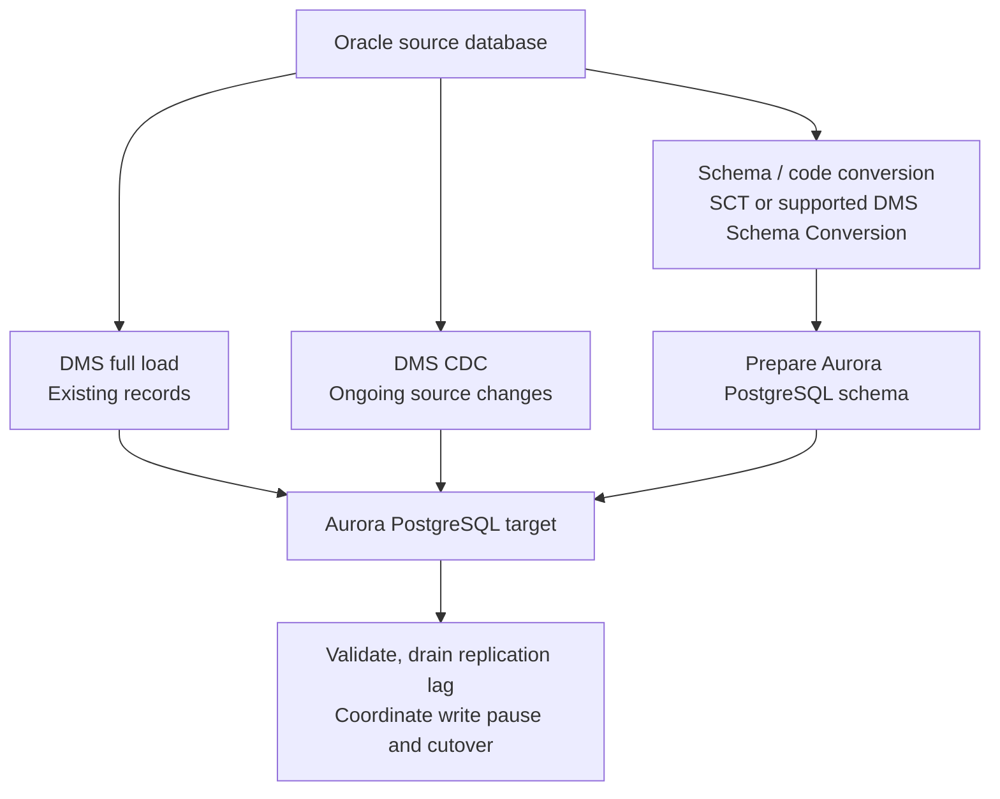
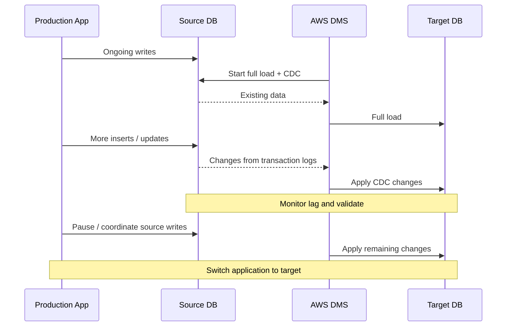
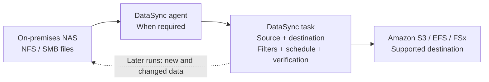
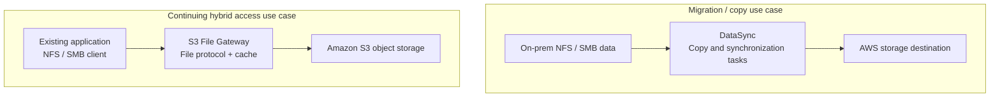
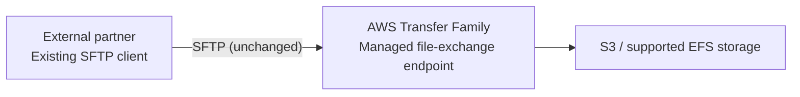
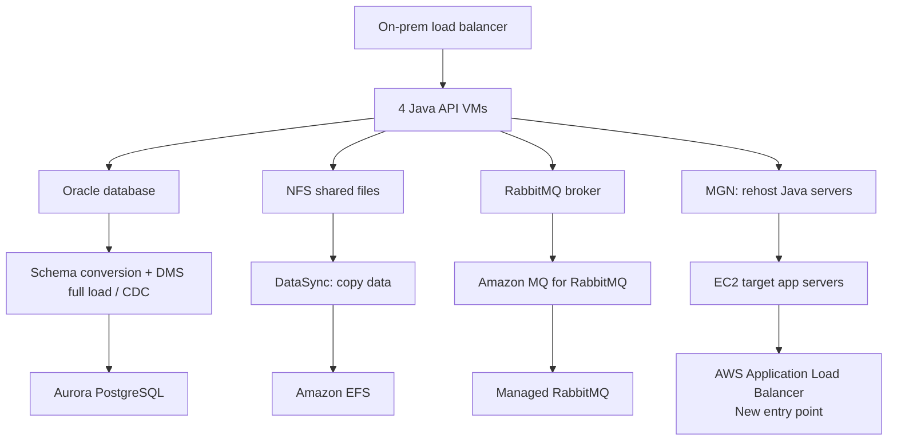

# Section 39: AWS Migration & Transfer Services — Complete SAA-C03 Teaching Guide

> **Read this to learn, not merely to refresh.** Section [37](37-GapFill-Services.md) is a fast service-recognition cheat sheet; Section [38](38-Migration-and-Transfer.md) is a decision-oriented refresher. This article explains the architecture, mechanisms, limitations, interactions and exam traps in depth.
>
> **Updated for November 2026.** Many older SAA-C03 practice questions use legacy AWS service names. Application Discovery Service and Migration Hub stopped accepting new customers November 7, 2025; the old Discovery Connector ended support November 17, 2025. AWS Application Migration Service was renamed **AWS Transform MGN** in June 2026. Historical question answers and current deployment guidance are **not always identical**. When an old exam option names a retired service, identify the historically intended architectural capability, then distinguish it from what AWS currently recommends.

## Table of contents

1. What "migration" actually means
2. Application Discovery Service: inventory and dependencies
3. Migration Hub: application-level tracking
4. AWS Transform and migration waves
5. AWS Transform MGN: server rehosting
6. DMS: database migration, schema conversion, CDC
7. DataSync: online file and object data movement
8. Storage Gateway: continuing hybrid storage access
9. Transfer Family: protocol-compatible file exchange
10. Migration Evaluator and the business case
11. Offline transfer, Direct Connect and Data Transfer Terminal
12. Seven migration strategies (7 Rs)
13. Related services and distractors
14. End-to-end migration walkthrough
15. Dissecting the original Tutorials Dojo question
16. Decision matrix and traps
17. Practice questions and detailed answers
18. Further reading

---

## 1. Migration is not just copying virtual machines

### Visual overview: the migration lifecycle

Imagine an enterprise datacenter with **500 VMware VMs, 20 physical servers, 80 applications, 60 databases and 300 TB of NFS/SMB storage**. Some applications exchange synchronous RPCs; others share a database or filesystem. Ownership and dependencies are only partially documented.

"Move everything to AWS" contains several independent problems:

1. **Discover:** What servers exist, what are their configurations and utilization, and which components depend on each other?
2. **Assess:** Are the workloads supported in AWS? What will they cost? Should they migrate, be replaced or be retired?
3. **Plan:** What belongs in an application? Which machines and databases must migrate together? What are the cutover windows and waves?
4. **Move:** Copy entire servers, migrate database records, copy files, or provide substitute managed services.
5. **Track and validate:** Are all of an application's components ready, tested and cut over? Did replication lag reach acceptable values?
6. **Operate/modernize:** Monitor, rightsize, secure and possibly refactor workloads after migration.

These verbs, **not the fact that a product has an agent**, select the service.

| Actual requirement | Legacy / relevant service | Technical level |
|---|---|---|
| Inventory on-premises servers, configuration, utilization and dependencies | Application Discovery Service (ADS); AWS Transform for new workflows | Host/dependency metadata |
| Centrally group applications and track their migration | Migration Hub (legacy); AWS Transform for new workflows | Migration portfolio |
| Evaluate on-premises-to-AWS costs/TCO | Migration Evaluator | Business case |
| Rehost a server's OS, installed software and disks on EC2 | Application Migration Service / **AWS Transform MGN** | Block-level server replication |
| Move relational database records and ongoing changes | Database Migration Service (DMS) | Database-level replication |
| Copy files/objects from on-premises storage to AWS storage | DataSync | Filesystem/object transfer |
| Preserve managed SFTP/FTPS/FTP/AS2 integrations | Transfer Family | Transfer protocol endpoint |
| Expose AWS-backed file, block or tape interfaces on premises | Storage Gateway | Hybrid storage access |
| Protect a server for failover after a disaster | Elastic Disaster Recovery (DRS) | Continuous DR replication |

**Same machine, different answers.** An on-premises PostgreSQL VM could be:

- **Discovered** with ADS to reveal configuration and connections.
- **Rehosted** intact to EC2 with MGN, retaining a self-managed PostgreSQL server.
- **Migrated at database level** to RDS PostgreSQL with DMS or native PostgreSQL tooling.
- **Backed up as files** and copied with a storage transfer method if file transfer is truly the requirement.
- **Tracked** as part of an application migration in legacy Migration Hub.
- **Protected for ongoing DR** using Elastic Disaster Recovery.

### How to read old exam questions in 2026

Do not confuse a practice bank's intended answer with the current preferred AWS architecture. ADS and Migration Hub were closed to **new** customers on November 7, 2025, and the VMware-focused legacy Discovery Connector is no longer supported. The current AWS Transform platform consolidates and extends multiple discovery, assessment and planning workflows. Its name is distinct from **AWS Transform MGN**, the rehosting engine.

In a legacy multiple-choice question with "Application Discovery Service + Migration Hub" as an option and no modern AWS Transform option, that can still be the **historically correct exam answer**. For a greenfield architecture today, evaluate current AWS Transform capabilities.

---

## 2. Application Discovery Service (ADS): discover before migrating

### Visual overview: discovery paths

### 2.1 The problem: inventory is not enough without context

Suppose the infrastructure team hands you a spreadsheet listing 500 hostnames. One VM is:

- Host: billing-prod-03
- Allocated: 8 vCPU, 32 GiB RAM, 500 GB disk
- Actual CPU average: 12%, but peak 65%
- Running processes: Java service, monitoring agent
- Network conversations: Oracle on port 1521; application peers on 8443

**Why care?**

**Rightsizing:** Recreating every on-prem virtual machine with identically sized EC2 capacity can waste money. But sizing only from averages is also unsafe; peak load, memory and IO constraints matter.

**Dependency mapping:** An application server may contact an Oracle database hundreds of times per request. If you migrate the application server but leave the database on premises, every interaction may cross a higher-latency link.

**Migration waves:** Closely coupled servers should often be assessed together. A hostname spreadsheet alone cannot reliably identify that coupling.

ADS was designed to collect infrastructure inventory, performance and dependency data for migration planning.

### 2.2 What it can gather

Depending on collection mechanism and configuration:

| Data class | Examples | Why it matters |
|---|---|---|
| Server configuration | Hostname, OS, CPU, memory, storage, IPs | Compatibility and sizing |
| Utilization | CPU/memory usage over time | Rightsizing / cost case |
| Processes | Running application/runtime processes | Workload identification |
| Network connections | IP/port relationships between processes/hosts | Application dependencies |
| VMware inventory | VM details through vCenter | Large hypervisor estate assessment |
| Database/analytics information | Supported inventory modules | Database migration assessment |

**Important limitation:** Identifying processes and network flows does not mean the tool reconstructs Java source code, business transactions, every RPC call's meaning or every hidden dependency. Observation and application understanding are not equivalent.

### 2.3 Agent-based discovery

The legacy **Application Discovery Agent** runs inside a supported source host operating system. It can collect host configuration, utilization, running processes and network connection data. It applies to physical and virtual servers, subject to the supported environments.

Conceptual flow:

    On-prem Linux/Windows server
      Java / database / processes / network connections
               |
         Discovery Agent
               |
       AWS Discovery Service
               |
       Migration planning inventory

Why install a guest agent? Because the hypervisor often knows how much CPU a VM used, but not the semantic details of the guest's running processes and network connections.

**Exam signals:** "Detailed process-level dependency discovery", "physical Windows/Linux servers", or "determine which applications communicate with which databases" — agent-based host discovery is a plausible historical answer.

### 2.4 Agentless discovery: VMware and vCenter

Installing an OS agent into 500 VMs is operationally expensive and may require change approvals. The **Agentless Collector** is a VMware appliance integrated with vCenter. It gathers supported VM inventory and utilization without a per-guest agent for those collection features. Additional collector modules may add network/database/analytics discovery capabilities; do not overgeneralize what **all** agentless modes can or cannot discover.

Conceptual flow:

    VMware vCenter
      |-- VM 1
      |-- VM 2
      |-- ...
      |-- VM 500
             |
       Agentless Collector appliance
             |
       AWS discovery inventory

**Agent vs agentless:** The decision hinges on supported environment, required depth of discovery and per-host operational burden. A physical server outside VMware is not inventoried by merely pointing a vCenter-focused appliance at a hypervisor.

### 2.5 Discovery Connector is not Agentless Collector

The original Tutorials Dojo question says "deploy the discovery connector".

The **Discovery Connector** was an older VMware-oriented appliance. The later **Agentless Collector** superseded that approach. The old connector ceased support in November 2025. Its name remains a useful clue to the *historical exam intent* but should **not** be treated as deployment guidance for a new migration.

### 2.6 What ADS does not do

ADS is **not** a tool that:

- Copies an OS installation to EC2.
- Converts Oracle PL/SQL into PostgreSQL code.
- Transfers a NAS dataset to S3.
- Performs application cutover or validation.
- Replaces an application migration progress tracker.

Inventory and dependency data enable migration decisions; they do not perform all migration work.

### 2.7 Three "agents" that are unrelated

| Agent | Location | Actual purpose |
|---|---|---|
| Discovery Agent | Guest operating system | Collect inventory, processes, connections |
| MGN replication agent | Guest/source server | Continuously replicate block-level server data |
| DataSync agent | Supported transfer environment | Read and transfer filesystem/object datasets |

**Never answer from the word "agent" alone.** First ask what is being collected or transferred.

References: [Tutorials Dojo ADS](https://tutorialsdojo.com/aws-application-discovery-service/), [AWS ADS documentation](https://docs.aws.amazon.com/application-discovery/latest/userguide/what-is-appdiscovery.html).

---

## 3. AWS Migration Hub: track applications, not just machines

### Visual overview: inventory + migration status

### 3.1 Why discovery does not solve progress tracking

Inventory has found six resources belonging to the Orders application:

    Orders application
      orders-web-01
      orders-web-02
      orders-api-01
      orders-api-02
      orders-db-01
      orders-batch-01

A manager asks: **"Has Orders migrated?"**

Two API nodes might have cut over, the database might still be replicating, and the worker might not have started. Merely knowing all six servers exist doesn't answer that question.

Legacy Migration Hub provides a central place to **group discovered servers into applications** and track migration status from supported migration tooling, including integrations with MGN and DMS.

    ADS inventory ------\
                         \
                          > Migration Hub application view
                         /
    MGN / DMS status ----/

The overall migration status of an application is distinct from individual server inventory and operational metrics.

### 3.2 Home Region

Migration Hub has a **home Region** for its discovery/migration-tracking information. The home Region does **not** imply every EC2 target or database migration must be in that Region. Do not confuse the tracking control plane with the workloads' destination Regions.

### 3.3 Migration Hub vs QuickSight vs CloudWatch

| Tool | Question it answers |
|---|---|
| Migration Hub | How far along is each application migration? |
| CloudWatch | What do logs, alarms and operational metrics say about systems? |
| QuickSight | What do our BI datasets and custom dashboards show? |

QuickSight can visualize a custom dataset, and CloudWatch can monitor application health, but neither automatically substitutes for the purpose-built legacy application migration tracking workflow.

### 3.4 Related Migration Hub capabilities

Older questions may name:

- **Strategy Recommendations:** help assess applications, runtimes and databases to propose modernization/migration approaches.
- **Orchestrator:** workflows, runbooks and orchestration for supported migrations.
- **Refactor Spaces:** incremental modernization/strangler-fig-style routing and application decomposition.
- **Migration Hub tracking:** centralized migration state reporting.

These are **not** synonyms. Planning strategy, executing workflow, refactoring application routes and reporting status are different problems.

### 3.5 Modern lifecycle warning

Migration Hub stopped accepting **new** customers November 7, 2025. AWS Transform is the modern platform to investigate for new discovery, planning and tracking workflows. Legacy practice questions still frequently ask about Migration Hub.

Reference: [Tutorials Dojo Migration Hub](https://tutorialsdojo.com/aws-migration-hub/).

---

## 4. AWS Transform and migration waves

### 4.1 AWS Transform vs AWS Transform MGN

These names sound more similar than their roles are.

**AWS Transform** covers a broader migration/transformation workflow: discovery, assessment, dependency analysis, migration planning, waves, automation and related modernization activities.

**AWS Transform MGN** (formerly Application Migration Service) is specifically the **server replication and rehosting engine**.

A migration management platform and a low-level server replication product are not interchangeable.

### 4.2 Migration waves

A company rarely should cut over all 500 VMs simultaneously. It might schedule:

| Wave | Workloads | Goal |
|---|---|---|
| 1 | 20 non-production servers | Test tools and validation |
| 2 | 30 low-risk internal applications | Test operational workflows |
| 3 | 100 customer-facing servers | Move cohesive application groups |
| 4 | 150 harder systems | Handle more complex dependencies |
| 5 | Remaining applications | Finish cutover and cleanup |

Wave planning is partly about **dependency topology** and **operational risk**. Consider an application server in AWS making thousands of synchronous SQL queries to a database still on premises: the added network latency can overwhelm a previously acceptable request-response path.

**Think in application groups**, not only individual server count.

References: [AWS Transform FAQ](https://aws.amazon.com/transform/faq/), [AWS Transform user guide](https://docs.aws.amazon.com/transform/latest/userguide/what-is-aws-transform.html).

---

## 5. AWS Transform MGN: rehost the entire server workload

### Visual overview: MGN block replication and cutover

### 5.1 What "lift-and-shift" actually means

Source:

    VMware Linux VM
      OS
      Java runtime + Tomcat
      Billing application
      Configuration and logs
      Attached virtual disks

Desired result:

    Amazon EC2
      Migrated OS and installed application
      Supported migrated disk content
      App still substantially unchanged

**MGN rehosts a server.** It does not automatically translate a Java monolith into Lambda, convert Oracle into Aurora PostgreSQL, or redesign your architecture.

### 5.2 Continuous block-level replication architecture

    On-prem / cloud / physical source
        MGN replication agent
                |
       Initial block replication
       + ongoing changed blocks
                |
        AWS staging resources
          staged EBS data
                |
        Test launch / cutover
                |
            Amazon EC2

Typical sequence:

1. Verify source OS/platform support and network prerequisites.
2. Install/configure the MGN agent on the source machine.
3. Start initial replication to AWS staging resources.
4. Continue replicating subsequent changed disk blocks.
5. Perform a **test launch** to a suitable isolated environment.
6. Validate OS boot, services, applications, dependencies, DNS, security and performance.
7. Coordinate a production cutover window.
8. Stop or quiesce writes as required and ensure replication reaches an appropriate state.
9. Launch target, redirect traffic, validate, then retire or preserve source according to the rollback plan.

### 5.3 Why block-level matters

Block replication operates below the application's records. MGN does not need to understand the semantics of a PostgreSQL row or a Java domain object to replicate disk changes.

This also explains **what it does not give you**:

- Moving a PostgreSQL VM to EC2 still leaves you managing PostgreSQL.
- Moving an Oracle VM to EC2 does not convert it to Aurora.
- Moving an application server alone may break connectivity to an unmoved database.

### 5.4 "Minimal downtime" is not "zero downtime"

Replication allows most data to be transferred before cutover while the source remains active. But a production cutover still needs careful handling of outstanding writes, cache state, external services, IP/DNS changes, transaction consistency, and rollback.

A test launch is particularly important. For example, a test copy of a payment worker must be isolated so it doesn't execute duplicate real-world payments while the original application continues running.

### 5.5 MGN vs DRS (Elastic Disaster Recovery)

Both can continuously replicate data from source systems, but **the business purpose is different**:

| Objective | Answer |
|---|---|
| Permanently migrate on-prem server to AWS EC2 | MGN |
| Continue primary on-prem operations and fail over after disaster | Elastic Disaster Recovery |
| Repeated DR drills and recoverability assurance | DRS |
| Replace source environment after one-time migration/cutover | MGN |

An exam question mentioning replication alone is ambiguous. The deciding words are **migration/cutover** versus **disaster/recovery/failover**.

### 5.6 What if there is a database on the source VM?

- Entire source server should run mostly unchanged on EC2 → MGN can be suitable.
- Database should move to managed RDS/Aurora while application platform changes → DMS/native DB migration and conversion are more appropriate.
- The source is only a NAS device and its files belong in S3 → DataSync more appropriate.

References: [AWS MGN FAQ](https://docs.aws.amazon.com/mgn/latest/ug/General-Questions-FAQ.html), [AWS MGN docs](https://docs.aws.amazon.com/mgn/latest/ug/what-is-application-migration-service.html).

---

## 6. AWS DMS: database records, full load, CDC and schema conversion

### Visual overview: heterogeneous database migration

### Visual timeline: why full load is not enough

### 6.1 Database-level vs server-level migration

An on-premises Linux VM running PostgreSQL contains OS binaries, the database engine, database files, logs, configs and services.

- **MGN** can rehost the machine on EC2, maintaining the self-managed database stack.
- **DMS** migrates data into a supported target database, which might be RDS PostgreSQL or Aurora PostgreSQL.
- Native PostgreSQL dump/restore or replication might be better in some specific scenarios: DMS is not automatically mandatory.

### 6.2 Homogeneous database migration

Examples:

- MySQL → RDS MySQL
- PostgreSQL → Aurora PostgreSQL
- Oracle → RDS Oracle

The source and target share the same or compatible database engine semantics. You still need to prepare users, schema, access permissions, constraints, extensions and target infrastructure as appropriate; "homogeneous" does **not** mean every object is handled magically.

### 6.3 Heterogeneous database migration

Example: Oracle → Aurora PostgreSQL.

The engines differ in SQL dialect, PL/SQL vs PL/pgSQL constructs, data types, packages, stored procedures and vendor-specific features.

Consider:

Oracle:

    SELECT SYSDATE FROM dual;

PostgreSQL:

    SELECT CURRENT_TIMESTAMP;

Real applications may have thousands of lines of engine-specific SQL and procedural code.

The work divides into:

**Schema/code conversion:** Traditionally **AWS Schema Conversion Tool (SCT)**, or supported **DMS Schema Conversion** workflows, plus manual remediation where automatic conversion is incomplete.

**Data movement/replication:** **AWS DMS** transfers table records and can continuously replicate changes.

**Crucial distinction:** DMS full load/CDC does not magically rework every stored procedure or every application's SQL query.

### 6.4 Full load, CDC and full load + CDC

| Mode | What happens | Exam cue |
|---|---|---|
| Full load | Copy existing source dataset | One-off initial data copy |
| CDC | Capture and apply ongoing source changes | Keep target synchronized |
| Full load + CDC | Initial data copy and subsequent ongoing changes | Low-downtime production database migration |

Suppose a 2 TB source database takes 12 hours to copy. Production users are still inserting orders during those 12 hours. A full load alone does not guarantee a cutover-ready target.

**CDC = change data capture.** Depending on source engine and configuration, it uses mechanisms such as MySQL binary logs, PostgreSQL logical replication/WAL, and Oracle redo-log-based capture.

Simplified process:

    Source database actively serving writes
          |
          | 1. Full load of existing rows
          | 2. Capture/replicate changes
          v
       Target database
          |
          | Monitor replication lag
          | Coordinate stop/quiesce source writes
          | Drain changes and validate
          v
       Application cutover

### 6.5 Why "CDC = zero downtime" is incorrect

CDC can make the final synchronization window smaller, but it does not eliminate all work needed for production cutover. Application connections, in-flight transactions, schema compatibility, consistency checks and redirecting endpoints still matter.

When using full load + CDC, do not switch as soon as the initial copy finishes; the replication may still be behind.

### 6.6 DMS architecture

Traditional DMS setups involve:

- Source endpoint and credentials/network access.
- Target endpoint.
- Replication infrastructure (replication instance or supported DMS Serverless model).
- Migration task (table mappings, transformations, full load vs CDC).
- Monitoring, logging and cutover validation.

**Networking trap:** A replication task doesn't succeed merely because source/target endpoints are declared. It must be able to connect to both databases, and source databases must allow the necessary reads/log access.

### 6.7 DMS vs DataSync vs MGN

| What is moved? | Choose |
|---|---|
| Entire OS and installed database server to EC2 | MGN |
| Database rows, table data, ongoing inserts/updates/deletes | DMS |
| Files such as NFS documents, images or backup archives | DataSync |
| Unsupported database schema constructs | Schema conversion/remediation |

References: [Tutorials Dojo DMS](https://tutorialsdojo.com/aws-database-migration-service/), [DMS user guide](https://docs.aws.amazon.com/dms/latest/userguide/Welcome.html).

---

## 7. AWS DataSync: online storage transfer

### Visual overview: file transfer with incremental passes

### 7.1 What problem it solves

Suppose you have an NFS share with 80 TB of files:

    /export/finance/invoices
    /export/finance/reports
    /export/engineering/builds
    /export/archive

You need to copy it to Amazon S3 or another supported AWS storage destination. DataSync is built to manage such data movement.

Depending on support and direction, it can transfer between on-premises **NFS/SMB/HDFS/object** locations and supported AWS storage, such as **S3, EFS and FSx**, and between other supported storage locations.

It is **not** a VM inventory collector.

### 7.2 Components

    On-prem NFS/SMB or object storage
                |
           DataSync agent
       (where agent is required)
                |
         DataSync transfer task
         - source location
         - destination location
         - filters and options
         - scheduling/verification
                |
             S3 / EFS / FSx

Not all AWS-to-AWS and supported cloud-to-cloud transfers require an on-premises agent. **Don't memorize "DataSync always needs an agent."**

### 7.3 Incremental transfers and cutover

For 100 TB of files:

1. Execute a large initial transfer while workloads remain operational.
2. Continue production operations.
3. Run subsequent tasks to transfer new or changed files.
4. At final cutover, stop or coordinate writes.
5. Run final synchronization, verify, and redirect consumers.

A subsequent task can compare data and transfer changes according to configured behavior, avoiding a full re-copy of all unchanged data.

**Distinction from database CDC:** DataSync manages file/object transfers. It does not tail a PostgreSQL transaction log and apply SQL row-level updates.

### 7.4 Validation, metadata and semantics

DataSync provides transfer verification choices and can preserve supported metadata where the source and destination semantics permit it.

But NFS POSIX permissions, SMB security descriptors and S3 object metadata are **not interchangeable concepts**. A copy into S3 does not automatically reproduce a fully POSIX-compatible filesystem.

Also remember: a successful file copy doesn't necessarily mean the target application can immediately replace an on-premises NFS mount with an S3 API.

### 7.5 DataSync vs S3 Transfer Acceleration

**DataSync:** Enumerates supported source data, controls transfer tasks, compares incremental changes, supports scheduling and verification.

**S3 Transfer Acceleration:** Speeds supported long-distance S3 uploads/downloads via AWS edge infrastructure; it is not an infrastructure discovery system or NAS-migration coordinator.

**Examples:**

- Browser/client uploading one big object to distant S3 → Transfer Acceleration may help.
- Company migrating a 60 TB SMB share to S3 → DataSync.
- Company importing 500 VMware VM inventory records → **not DataSync**.

### 7.6 DataSync vs Direct Connect

**Direct Connect provides connectivity**, not file enumeration, scheduled tasks or file checksum/verification logic.

A DataSync job can use a suitable network path, including Direct Connect, without Direct Connect replacing the DataSync application-level functionality.

### 7.7 DataSync vs AWS Backup / S3 Replication

- **DataSync:** Copy/synchronize datasets between supported storage locations.
- **AWS Backup:** Govern backups, schedules, retention and recovery for supported resources.
- **S3 Replication:** Replicate eligible S3 objects between S3 buckets according to configured rules.

Copying a corrupted source file to a destination does not by itself provide versioned backup recovery. Don't treat DataSync as a complete retention or disaster-recovery solution.

References: [Tutorials Dojo DataSync](https://tutorialsdojo.com/aws-datasync/), [How DataSync transfer works](https://docs.aws.amazon.com/datasync/latest/userguide/how-datasync-transfer-works.html).

---

## 8. AWS Storage Gateway: hybrid access, not simply migration

### Visual overview: DataSync vs Storage Gateway

The recurring difference:

> **DataSync moves data. Storage Gateway presents storage interfaces.**

Suppose existing on-prem applications must continue using NFS, SMB, iSCSI or tape workflows while the storage integrates with AWS.

| Gateway | What local client sees | Example |
|---|---|---|
| **S3 File Gateway** | NFS/SMB file share | Existing software writes files into AWS-backed object storage without direct S3 API calls |
| **Volume Gateway** | iSCSI block volumes | Workloads need block interfaces and AWS-integrated storage/snapshots |
| **Tape Gateway** | Virtual tape library | Existing backup software expects a tape workflow |

### 8.1 File Gateway

    Existing application
       NFS / SMB
           |
      S3 File Gateway
           |
         Amazon S3

This is **not** the same as copying an existing NFS share once and requiring every application to use S3 REST calls immediately. It can preserve a file-access interface and uses gateway-specific caching/behavior.

### 8.2 Volume Gateway

An OS sees an iSCSI block device it can partition/format/mount. That is not the same abstraction as an S3 object or DataSync copy task.

### 8.3 Tape Gateway

Some enterprises still have backup products designed around tape libraries. Tape Gateway offers a virtual-tape integration path without requiring the application to become a file-copy scheduler.

### 8.4 When DataSync and Storage Gateway cooperate

A migration might use DataSync for an initial bulk data transfer and a suitable gateway for ongoing access, **but** carefully evaluate which storage and protocol semantics are required. Merely putting bytes in S3 does not make every old filesystem workload instantly compatible.

Reference: [AWS Storage Gateway docs](https://docs.aws.amazon.com/storagegateway/latest/userguide/WhatIsStorageGateway.html).

---

## 9. AWS Transfer Family: legacy file-transfer protocols without managing the server

### Visual overview: protocol preservation

A partner has a hard-coded nightly workflow:

    Partner legacy SFTP client
              |
        on-prem SFTP host
              |
           files

The company wants S3 storage but cannot require all partners to rewrite integrations.

Conceptual replacement:

    Existing partner SFTP client
               |
       AWS Transfer Family
               |
           S3 / EFS
        (supported setup)

Transfer Family supports managed **SFTP, FTPS, FTP** and **AS2** scenarios, subject to specific protocol, endpoint, identity and storage-backend support.

### Why not DataSync?

DataSync is an orchestrated storage-transfer service. It doesn't replace an externally reachable SFTP server endpoint that existing clients expect.

### Why not S3 presigned URLs?

Presigned HTTPS S3 URLs can work for clients you control that can use HTTP. They do not satisfy a partner whose tooling can **only** use SFTP.

### Why not Amazon MQ?

MQ is a **message broker** (e.g., existing RabbitMQ/ActiveMQ protocol compatibility). Transfer Family is **file exchange**. AMQP/JMS are not SFTP/FTPS.

**Signals:**

- "External partner can't change their SFTP automation" → Transfer Family.
- "Copy many TB from NFS/SMB to S3 as a scheduled task" → DataSync.
- "Migrate existing RabbitMQ messaging with minimal rewrite" → Amazon MQ.

Reference: [Tutorials Dojo Transfer Family](https://tutorialsdojo.com/aws-transfer-family/).

---

## 10. Migration Evaluator: the financial case

The CFO asks:

> "Before we commit to migrating 1,000 servers, estimate what AWS will cost compared with keeping the datacenter."

That's different from asking for a VM inventory or migration-status report.

Migration Evaluator helps collect/use inventory and utilization data to build a **TCO/business case** and right-sized AWS cost scenarios.

Why utilization matters:

- Allocated 32 vCPUs ≠ 32 vCPUs worth of real usage.
- 8% average CPU ≠ safe to provision for only 8% (peaks, memory and IO still matter).
- On-prem licensing, maintenance, refresh cycles and operating costs contribute to the comparison.

### Similar-sounding services

| Service | Primary question |
|---|---|
| Migration Evaluator | Does migrating to AWS make economic sense, and what might it cost? |
| AWS Pricing Calculator | What would a specified AWS configuration cost? |
| Compute Optimizer | How can supported existing AWS resources be rightsized? |
| Migration Hub | How is an application migration progressing? |
| QuickSight | How do we analyze or chart general datasets? |

A custom QuickSight dashboard is not the same as a purpose-built migration assessment workflow.

Reference: [Tutorials Dojo Migration Evaluator](https://tutorialsdojo.com/migration-evaluator-cheat-sheet/).

---

## 11. Offline transfer, networking and large datasets

### 11.1 Why use physical transfer at all?

If the source has **500 TB** and the *effective* upload rate is **100 Mbps**, theoretical transfer time, ignoring protocol overhead and competing use, is roughly **463 days**. At **1 Gbps**, it's approximately **46 days**.

The data volume relative to usable bandwidth can make an offline strategy attractive.

### 11.2 Snowball Edge (legacy)

Historically AWS shipped Snowball Edge devices to customers, who copied local data onto the device and shipped it back for ingestion. Some offerings also supported edge computing.

**2026 lifecycle caveat:** Snowball Edge was closed to new customers on November 7, 2025. Learn the historical exam pattern but don't recommend a new Snowball order without checking current eligibility and regional availability.

### 11.3 Data Transfer Terminal

AWS Data Transfer Terminal uses a different physical model: bring approved portable storage to a supported AWS transfer location for high-speed ingest.

**Physical flow comparison:**

- Snowball: AWS sends an AWS-managed device to your site (historical model).
- Data Transfer Terminal: you bring suitable storage media to the AWS facility.

### 11.4 Direct Connect / Site-to-Site VPN

Neither is a file-transfer engine:

- **Direct Connect** offers dedicated network connectivity to AWS through supported facilities.
- **Site-to-Site VPN** provides encrypted IPsec connectivity, typically over underlying IP networks.
- **DataSync/DMS/MGN** carry out their workload-specific transfers over suitable networks.

### 11.5 Initial seed then delta transfer

A common pattern is large initial transfer followed by ongoing smaller updates and a final cutover:

- DataSync incremental tasks for supported file/object datasets.
- DMS CDC for database changes.
- MGN block-level replication for server rehosting.

**These are NOT the same synchronization protocol.** Choose based on what needs to remain consistent.

References: [Tutorials Dojo migration/transfer index](https://tutorialsdojo.com/aws-cheat-sheets-migration-transfer-services/), [AWS Data Transfer Terminal](https://aws.amazon.com/data-transfer-terminal/).

---

## 12. Seven migration strategies: pick the strategy before the tool

| Strategy | Meaning | Example | Exam distinction |
|---|---|---|---|
| **Rehost** | Move largely unchanged | VMware server → native EC2 with MGN | Lift-and-shift |
| **Replatform** | Limited optimization with no fundamental rewrite | Self-managed MySQL → RDS MySQL | Lift-and-tinker |
| **Refactor / rearchitect** | Redesign application architecture | Monolith → microservices/serverless | More invasive engineering |
| **Repurchase** | Replace product with another, often SaaS | Custom CRM → SaaS CRM | Not an EC2 migration |
| **Relocate** | Move at the virtualization/platform layer | VMware environment to compatible hosted platform | Distinct from native EC2 rehost |
| **Retain** | Keep workload where it is | Regulatory blocker | Delay/decline migration |
| **Retire** | Decommission workload | Unused reporting application | No cloud runtime needed |

### 12.1 Rehost

Move the VM/server workload onto EC2 with minimal changes. This often preserves operational debt but reduces immediate rewrite effort.

### 12.2 Replatform

Keep much of the application's structure while replacing a component with a managed service. Moving MySQL into RDS MySQL is classic: you alter the operations platform, not necessarily all application logic.

### 12.3 Refactor

Change significant architecture: e.g., extract services from a monolith, rework deployment and scaling, introduce decoupled event-driven flows. MGN does not perform this redesign automatically.

### 12.4 Repurchase

Replace old functionality with SaaS. Data conversion and integrations may still be nontrivial, but the old application's runtime isn't migrated.

### 12.5 Relocate

Move a virtualization/platform environment rather than separately rehosting workloads as native EC2 instances. Older exam examples reference VMware-on-AWS products; verify current product availability outside a legacy test.

### 12.6 Retain

Leave a workload where it is for legal, contractual, technical or business reasons. A good migration program need not migrate *everything*.

### 12.7 Retire

Turn off systems no longer used. Inventory/discovery can reveal applications that should disappear rather than migrate.

**Exam traps:** Replatform ≠ refactor; relocate ≠ rehost; retain ≠ retire. Don't jump immediately from "migration" to "MGN."

Reference: [Tutorials Dojo — the 7 Rs](https://tutorialsdojo.com/aws-migration-strategies-the-7-rs/).

---

## 13. Additional distractors in migration questions

- **Amazon MQ:** Existing RabbitMQ/ActiveMQ-style broker integrations and supported messaging protocols; not bulk file migration or transfer of VM disks.
- **AWS App2Container (legacy terminology):** Containerization of existing applications; not the same as block-level VM rehosting. Check current tooling/lifecycle before greenfield use.
- **AWS Backup:** Backups, schedules, retention and recovery for supported resources. A backup may be involved in migration, but Backup ≠ MGN/DMS.
- **Amazon S3 Replication:** S3-bucket object replication, not on-premises NAS discovery.
- **Amazon S3 Transfer Acceleration:** WAN-optimized S3 uploads/downloads, not file discovery/copy orchestration.
- **AWS Config:** AWS resource configuration inventory and compliance tracking, not discovery of a VMware datacenter.
- **CloudWatch:** Application/infrastructure metrics and monitoring; not native migration-portfolio tracking.
- **QuickSight:** BI visualizations; a possible custom dashboard destination, not the purpose-built migration tracker.
- **AWS Mainframe Modernization / AWS Transform for mainframe:** Specialized mainframe assessment/migration/modernization rather than generic Linux VM rehosting.
- **AWS Systems Manager hybrid activations:** Manage supported on-prem hosts operationally, but not equivalent to an application migration discovery program.

---

## 14. Worked enterprise example: migrating a payments application

### Visual overview: one application, several AWS migration tools

Source architecture:

    Datacenter load balancer
              |
        Four Java API VMs
              |
          +---+---+
          |       |
      Oracle DB  NFS share
          |
      RabbitMQ broker

Goals: run in AWS, reduce operations burden, preserve existing partner behavior, and minimize downtime.

### A. Discover

Find all VMs, physical servers, CPU/memory/storage, running processes and database/network dependencies. Historically ADS feeds Migration Hub; a current new project would assess AWS Transform.

Key risk: synchronous Java → Oracle calls could incur unacceptable latency if application and database migrate in different waves.

### B. Decide a strategy for **each component**

| Component | Possible strategy | Service |
|---|---|---|
| Java API VMs | Rehost | AWS Transform MGN → EC2 |
| Oracle database | Replatform / heterogeneous engine migration | DMS plus schema conversion as required |
| NFS data | Storage dataset migration | DataSync → EFS |
| RabbitMQ | Managed compatible broker | Amazon MQ for RabbitMQ |
| Legacy load balancer | Replace component | ALB if application protocol fits |
| Entire application | Track wave and cutover | AWS Transform / legacy Migration Hub |

There is **no single service** that replaces all these actions.

### C. Transfer and prepare

- Start MGN block-level replication for servers to be rehosted.
- Provision target DB, convert schema if changing engine, run DMS full load + CDC.
- Start DataSync initial file copy, then incremental updates.
- Set up target networking, security groups, secrets and identity, monitoring and dependency routing.

### D. Test

The fact that an EC2 instance boots means little unless the application can authenticate to its target DB, read shared files, use RabbitMQ, serve requests and satisfy nonfunctional requirements.

Avoid test systems issuing real financial transactions while production is still online.

### E. Cut over

1. Coordinate application pause/maintenance.
2. Ensure DB CDC and required file synchronization catch up.
3. Launch target servers and validate application state.
4. Redirect DNS/load balancing and integrations.
5. Watch application metrics and business outcomes.
6. Execute rollback if agreed validation criteria fail.

Migration **tracking** lives above all these individual technical operations.

---

## 15. Original Tutorials Dojo question: exactly why answer 4 wins

> "A company has hundreds of on-premises virtual machines. **Before** migration, management wants an **inventory of servers** and to **track migration status for every application**."

Decompose requirements:

1. **Inventory the datacenter** → Application Discovery Service (legacy) and VMware discovery connector/collector terminology.
2. **Group servers and track application migration** → Migration Hub (legacy).

Answer evaluation:

**A. MGN + QuickSight — wrong.** MGN replicates server disks for rehosting; QuickSight is general BI. This combination does not match the purpose-built discovery plus app-tracking workflow.

**B. DataSync agent → S3 + Migration Hub — wrong.** The tracking component is plausible, but DataSync does **not** enumerate VMs and build a server dependency inventory.

**C. DataSync agent → S3 + QuickSight — wrong.** Both components solve adjacent-but-different problems: storage copying and analytics dashboards.

**D. ADS discovery connector + Migration Hub — correct *legacy exam intent*.** Inventory first, group and track applications centrally. **Modern qualification:** the Discovery Connector is retired and ADS/Migration Hub are closed to new customers; consider AWS Transform for current deployment.

If the question instead said "perform the actual low-downtime server rehost," **MGN** would be the stronger answer. If it said "transfer 80 TB from NFS to S3," choose **DataSync**.

---

## 16. Fast decision matrix after learning the details

| Question wording | Think | Not |
|---|---|---|
| Inventory on-prem servers/dependencies | ADS legacy / AWS Transform current | DataSync |
| Detailed host-level process/network discovery | Discovery Agent legacy | MGN agent |
| VMware VM metadata without installing on each guest | Agentless Collector legacy | DMS |
| View each application's migration progress | Migration Hub legacy / new Transform workflow | QuickSight alone |
| New migration-wave assessment | AWS Transform | Old Discovery Connector |
| On-prem-to-AWS cost/TCO analysis | Migration Evaluator | CloudWatch |
| Rehost server unchanged | AWS Transform MGN | DataSync |
| Ongoing protection and disaster failover | Elastic Disaster Recovery | One-time MGN migration |
| Database table data + CDC | DMS | DataSync |
| Convert Oracle schema/code to PostgreSQL | Schema conversion plus data migration | DMS row replication alone |
| NFS/SMB/HDFS bulk online copy | DataSync | ADS |
| Ongoing AWS-backed NFS/SMB access | Storage Gateway File Gateway | Simple one-time copy |
| Present iSCSI volume | Storage Gateway Volume Gateway | S3 API |
| Virtual tape library | Tape Gateway | Transfer Family |
| Existing partners insist on SFTP | Transfer Family | S3 Transfer Acceleration |
| Faster uploads from far-away internet clients | S3 Transfer Acceleration | Migration Hub |
| Dedicated on-prem connectivity | Direct Connect | DataSync |
| Very large data ingest where bandwidth is inadequate | Supported physical-ingest approach | DMS |
| Existing RabbitMQ integration | Amazon MQ | Transfer Family |
| Move VM without redesign | Rehost | Refactor |
| Self-managed MySQL to RDS | Replatform | Relocate |
| Significant architectural redesign | Refactor | Rehost |
| Replace app with SaaS | Repurchase | MGN |
| Keep application in current datacenter | Retain | Retire |
| Shut down unused app | Retire | Retain |

### Ten subtle traps

1. **"Agent" tells you almost nothing.** Ask whether it is capturing inventory, replicating blocks or copying files.
2. **"Dashboard" tells you almost nothing.** Migration tracking ≠ operational telemetry ≠ BI.
3. **"Replication" is overloaded.** Disk blocks (MGN/DRS), DB changes (DMS CDC), file/object updates (DataSync), S3 object replication are different mechanisms.
4. **"Low downtime" isn't a service name.** Identify whether the unit is a complete server, a database or a file dataset.
5. **"The source is on-prem" doesn't automatically imply Outposts or Direct Connect.** One denotes on-prem AWS infrastructure; the other network connectivity.
6. **"Everything is in S3" doesn't automatically imply DataSync.** S3 may be a destination for files, logs, backups or BI datasets.
7. **"Database migration" might be MGN** when the actual goal is to rehost the whole DB server; DMS if moving database records to a new engine/service.
8. **"Heterogeneous" means engine conversion matters.** DMS replication alone doesn't rewrite all code/schema.
9. **"Current AWS recommendation" ≠ old exam vocabulary.** ADS/Hub/Connector answers must be interpreted historically.
10. **AWS Transform ≠ AWS Transform MGN.** One is a broader platform; the other is specifically server rehosting.

---

## 17. Scenario drills (attempt before reading answers)

### Q1 — VMware inventory without per-guest agents

A company needs a pre-migration inventory of 600 VMware VMs, with supported performance data, and doesn't want to install an agent into each guest. Which legacy discovery method best fits?

A. AWS MGN replication agents  
B. Application Discovery Service Agentless Collector  
C. AWS DataSync agent  
D. DMS replication instance

### Q2 — Physical server dependencies

A team needs detailed processes and network connections on supported physical Linux servers to identify application groupings. Which legacy approach is strongest?

A. Discovery Agent inside each supported server  
B. DataSync task  
C. CloudWatch dashboard only  
D. S3 Replication

### Q3 — Rehost 800 servers

A company wants to move a fleet of physical and virtual servers to EC2 with minimal changes and low cutover downtime.

A. DataSync  
B. Transfer Family  
C. AWS Transform MGN  
D. Migration Evaluator

### Q4 — Compare infrastructure cost

The CFO wants on-prem infrastructure TCO compared with right-sized AWS scenarios before approving the migration.

A. Migration Evaluator  
B. Migration Hub tracking  
C. DMS CDC  
D. Transfer Family

### Q5 — Oracle to Aurora PostgreSQL

An Oracle application has incompatible PL/SQL and a database that must remain online during initial migration.

A. MGN only  
B. DataSync incremental file transfer only  
C. Schema conversion plus DMS full load and CDC  
D. QuickSight plus CloudWatch

### Q6 — Storage migration

A team must migrate an on-prem SMB share to S3 with transfer verification and follow-up incremental synchronization.

A. ADS  
B. DataSync  
C. MGN  
D. DMS

### Q7 — Keep SFTP clients

A supplier's nightly integration can only upload using SFTP. The new backend should store files in S3.

A. Transfer Family  
B. DataSync only  
C. DMS  
D. S3 Replication only

### Q8 — Hybrid access

A legacy application must continue mounting an NFS share, but the organization wants AWS-backed object storage.

A. S3 File Gateway  
B. MGN  
C. Migration Hub  
D. DMS

### Q9 — DR instead of migration

A company is keeping its primary datacenter but requires continuous server replication and recovery into AWS after a disaster.

A. MGN planned cutover  
B. Elastic Disaster Recovery  
C. QuickSight  
D. Migration Evaluator

### Q10 — New 2026 discovery project

A new AWS customer needs to discover virtualized infrastructure and coordinate migration waves, but an old practice question recommends Application Discovery Service and its Discovery Connector.

A. Deploy the old connector unchanged  
B. Begin with current AWS Transform migration/discovery capabilities  
C. Install DataSync as the VM discovery agent  
D. Use DMS for VM inventory

### Answers and reasoning

1. **B** — Agentless Collector supports VMware inventory/discovery workflows without per-guest agents for supported collection features. MGN does server block replication.
2. **A** — Guest-level discovery agents give process/network information on supported physical hosts.
3. **C** — MGN rehosts whole server workloads.
4. **A** — Migration Evaluator addresses business case and TCO, not migration status.
5. **C** — Heterogeneous engines require schema/code work; DMS full load + CDC handles data and changes.
6. **B** — DataSync transfers supported filesystem data, can perform subsequent incremental tasks and verify transfers.
7. **A** — Transfer Family preserves an externally visible SFTP endpoint.
8. **A** — File Gateway presents file protocols for AWS-backed storage; DataSync alone doesn't provide continuing NFS interface.
9. **B** — Ongoing disaster recovery, not one-time server cutover.
10. **B** — ADS/Hub were closed to new customers and the old Connector retired; AWS Transform is the appropriate modern starting point.

If you got one wrong, diagnose which **abstraction level** you confused; don't merely memorize the service label.

---

## 18. References (read alongside this guide)

### Tutorials Dojo

1. [Migration & Transfer services index](https://tutorialsdojo.com/aws-cheat-sheets-migration-transfer-services/)
2. [Application Discovery Service](https://tutorialsdojo.com/aws-application-discovery-service/)
3. [Migration Hub](https://tutorialsdojo.com/aws-migration-hub/)
4. [AWS Transform MGN / Application Migration Service](https://tutorialsdojo.com/aws-transform-mgn/)
5. [AWS Database Migration Service](https://tutorialsdojo.com/aws-database-migration-service/)
6. [DataSync](https://tutorialsdojo.com/aws-datasync/)
7. [Transfer Family](https://tutorialsdojo.com/aws-transfer-family/)
8. [Migration Evaluator](https://tutorialsdojo.com/migration-evaluator-cheat-sheet/)
9. [The 7 Rs](https://tutorialsdojo.com/aws-migration-strategies-the-7-rs/)

### Official AWS references / current-lifecycle verification

- [Application Discovery Service](https://docs.aws.amazon.com/application-discovery/latest/userguide/what-is-appdiscovery.html)
- [Application Discovery Service availability change](https://docs.aws.amazon.com/application-discovery/latest/userguide/application-discovery-service-availability-change.html)
- [Migration Hub availability change](https://docs.aws.amazon.com/migrationhub/latest/ug/migrationhub-availability-change.html)
- [AWS Transform](https://aws.amazon.com/transform/faq/)
- [MGN FAQ](https://docs.aws.amazon.com/mgn/latest/ug/General-Questions-FAQ.html)
- [DMS user guide](https://docs.aws.amazon.com/dms/latest/userguide/Welcome.html)
- [DataSync transfer mechanics](https://docs.aws.amazon.com/datasync/latest/userguide/how-datasync-transfer-works.html)
- [Storage Gateway user guide](https://docs.aws.amazon.com/storagegateway/latest/userguide/WhatIsStorageGateway.html)
- [AWS Data Transfer Terminal](https://aws.amazon.com/data-transfer-terminal/)

**Final model:** Discovery tells you *what exists*; assessment tells you *what makes sense*; planning tells you *what moves together*; migration tools move *different kinds of things*; tracking tells you *what has finished*. When the exam distractors all mention AWS services, identify the **verb + object** before looking at the answer choices.
